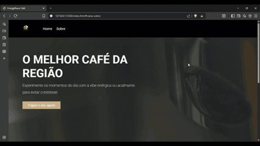

<p align="center">
  
</p>

<p align="center">
  <strong>Landing page de cafeteria com carrinho simulado no front-end</strong><br>
  <a href="https://coffe-peace.vercel.app">Ver no ar</a>
</p>

---

Landing page interativa com foco em experiência do usuário, design minimalista e
simulação de funcionalidades de e-commerce inteiramente no navegador.

---

## 🚀 Demonstração

🔗 **Projeto Online:**  
https://coffe-peace.vercel.app  

💻 **Repositório:**  
https://github.com/RyanZine/Coffe-Peace  

---

## 📸 Preview



---

## 🛠️ Tecnologias

- HTML5  
- CSS3  
- JavaScript (Vanilla)

---

## 🎯 Objetivo

Este projeto foi desenvolvido com o objetivo de evoluir habilidades em desenvolvimento front-end, com foco em:

- Estruturação semântica com HTML  
- Estilização moderna e responsiva com CSS  
- Manipulação do DOM com JavaScript  
- Criação de interatividade no lado do cliente  

---

## ✨ Funcionalidades

- Layout moderno e minimalista  
- Responsividade para diferentes dispositivos  
- Sistema de carrinho de compras 🛒  
- Adição e remoção de produtos  
- Cálculo automático do total  
- Persistência de dados com **localStorage**  
- Feedback visual com notificações (toast)  
- Navegação fluida entre seções  

---

## 🧠 Aprendizados

Durante o desenvolvimento, foram trabalhados conceitos importantes como:

- Manipulação de eventos no JavaScript  
- Atualização dinâmica da interface (DOM)  
- Organização e separação de responsabilidades (HTML, CSS e JS)  
- Resolução de bugs reais (scroll, renderização e interação)  

---

## ▶️ Como executar

```bash
# Clone o repositório
git clone https://github.com/RyanZine/Coffe-Peace.git

# Acesse a pasta
cd Coffe-Peace

# Abra o arquivo index.html no navegador