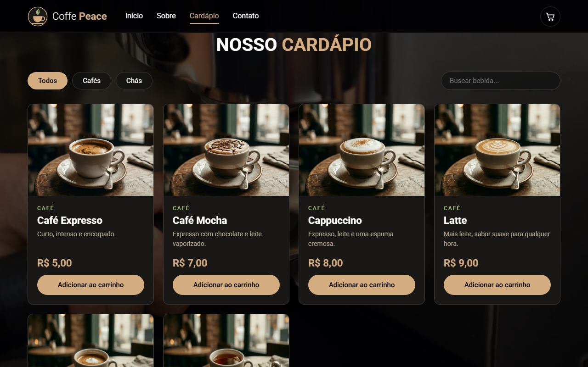
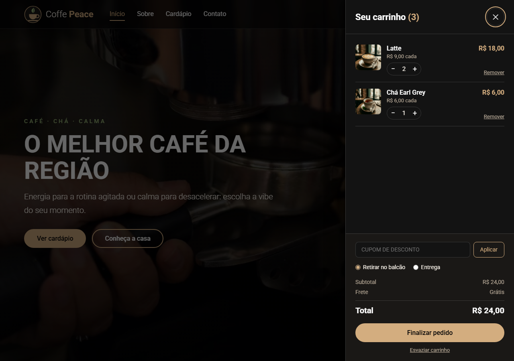

<p align="center">
  
</p>

# Coffe Peace — Cafeteria online com balcão e painel do lojista

O **Coffe Peace** é uma cafeteria fictícia com o fluxo completo de um comércio, do pedido do cliente até a retirada no balcão:

* **Cliente** (`index.html` + `pedido.html`): cardápio com filtro e busca, carrinho com cupom e frete, checkout e acompanhamento do pedido.
* **Funcionário** (`balcao.html`): entra com o **PIN da loja**, recebe os pedidos, prepara, marca como pronto e entrega. Também marca itens esgotados.
* **Lojista** (`lojista.html`): controle da loja, com resumo do dia, todos os pedidos, cardápio e preços, cupons, troca do PIN do balcão e restauração da demonstração.

> **Teste o fluxo:** faça um pedido na loja e abra o [balcão](https://coffe-peace.vercel.app/balcao.html) em outra aba (PIN **1234**). O pedido aparece na hora, e cada mudança de status chega à página de acompanhamento do cliente.

🔗 **Projeto online:** https://coffe-peace.vercel.app

<p align="center">
  
  
</p>

---

## 🎯 Objetivo

### Objetivo Técnico

Demonstrar um sistema de pedidos com três papéis em HTML, CSS e JavaScript puros, sem build, cobrindo:

* **Uma camada de dados única** (`js/dados.js`): loja, balcão e lojista só chamam funções como `criarPedido` e `avancarStatus`. Trocar onde os dados moram não muda nenhuma tela.
* **Regras de negócio fora da tela:** preço, cupom e frete são recalculados pela camada de dados a partir do cardápio cadastrado, nunca a partir do carrinho.
* **Atualização entre abas:** o pedido feito numa aba aparece no balcão aberto em outra, sem recarregar.
* **Integração desacoplada** com um serviço de recuperação de carrinho (CartBoost.AI), na branch de testes.

---

## 👥 Público-Alvo

| Segmento | Dor | Como o Coffe Peace resolve |
| --- | --- | --- |
| **Cafeterias e pequenos negócios** | Pedido anotado em papel; cliente sem saber quando fica pronto | Pedido online, fila no balcão e acompanhamento do status |
| **Donos de loja** | Não sabem quanto venderam no dia nem o que sai mais | Resumo do dia com faturamento, ticket médio e mais vendidos |
| **Testes do CartBoost.AI** | Precisa de um comércio real para provar a recuperação de carrinho | Loja com checkout, e-mail e eventos de funil (branch `supabase-cartboost`) |
| **Recrutadores** | Avaliar um projeto além da landing page | Fluxo completo e testável no navegador, em três telas |

---

## 🧭 Como funciona

```
   CLIENTE                      CAMADA DE DADOS (js/dados.js)             EQUIPE
   ───────                      ─────────────────────────────             ──────
   index.html ── carregarProdutos() ◄──── cardápio ────── atualizarProduto() ── lojista.html
       │
       │ checkout: ids + quantidades
       ▼
   criarPedido() ─────────► calcula preço, cupom e frete
       │                    grava o pedido ─── aviso entre abas ───►  balcao.html
       │ código do pedido                                                │
       ▼                                                                 │ avancarStatus()
   pedido.html ◄── consultarPedido() ◄── recebido → preparando → pronto → entregue
```

### 1. Cliente

* **Cardápio:** vem da camada de dados, ou seja, é o mesmo que o lojista edita. Produto esgotado aparece em cinza, com o botão desativado, e sai do carrinho de quem já o tinha.
* **Carrinho:** fica salvo no `localStorage` (chave `carrinho-v2`), com migração do formato antigo e limpeza de dados corrompidos.
* **Checkout:** pede só o nome. `criarPedido()` recusa produto esgotado, quantidade fora de 1 a 20 e cupom inválido, calcula o total com os preços cadastrados e devolve o número do pedido e um **código aleatório de acompanhamento**.
* **Acompanhamento:** `pedido.html?c=<código>` mostra a linha do tempo do pedido e se atualiza sozinho. Sem código, lista os últimos pedidos feitos naquele navegador.

| Regra | Valor |
| --- | --- |
| Cupom inicial | `PEACE10` → 10% de desconto (o lojista cria outros) |
| Taxa de entrega | R$ 5,00 |
| Frete grátis | pedidos a partir de R$ 40,00, depois do desconto |
| Retirada no balcão | sempre grátis |

### 2. Funcionário (balcão)

* **Entrada:** o PIN da loja, que é **um só para a equipe**, porque o tablet do balcão é compartilhado. Na demonstração o PIN padrão é `1234`, e o lojista pode trocá-lo.
* **Quadro:** quatro colunas (Recebidos, Preparando, Prontos, Entregues) com os pedidos de hoje. O pedido novo chega com destaque e aviso, e fica destacado até alguém agir nele.
* **Status:** só anda para a frente. Cancelar é possível até o preparo e pede confirmação.
* **Esgotados:** um clique tira o item da vitrine na hora.

### 3. Lojista

| Aba | O que faz |
| --- | --- |
| Resumo | Pedidos, faturamento, ticket médio, os três mais vendidos e a fila atual |
| Pedidos | Todos os pedidos de hoje, com status, e cancelamento dos que ainda não foram preparados |
| Cardápio | Editar nome, preço e descrição, cadastrar produto e marcar esgotado |
| Cupons | Criar, ativar e desativar |
| Ajustes | Trocar o PIN do balcão e restaurar a demonstração |

---

## 🗄️ Onde ficam os dados

| Versão | Onde | Para quê |
| --- | --- | --- |
| **`main`** (publicada) | `localStorage` do navegador | Demonstração pública e segura: cada visitante tem a própria loja e nada sai do navegador |
| **`supabase-cartboost`** (testes) | Supabase (PostgreSQL com RLS e funções `plpgsql`) e pixel do CartBoost.AI | Dados compartilhados entre aparelhos, regras no banco e prova da recuperação de carrinho por e-mail |

As duas versões usam a **mesma lista de funções** em `js/dados.js`. A branch troca só esse arquivo e adiciona o banco.

---

## 📋 Requisitos do Sistema

### Requisitos Funcionais (RF)

* **RF01 — Cardápio:** exibir os produtos cadastrados, com filtro, busca e indicação de esgotado.
* **RF02 — Carrinho:** adicionar, alterar quantidade, remover, aplicar cupom e escolher recebimento.
* **RF03 — Checkout:** criar o pedido com total calculado pela camada de dados.
* **RF04 — Acompanhamento:** mostrar ao cliente o status do pedido.
* **RF05 — Balcão:** entrar com PIN, listar os pedidos do dia e avançar o status.
* **RF06 — Cardápio da loja:** editar produtos, cadastrar novos e marcar esgotado.
* **RF07 — Cupons:** criar, ativar e desativar.
* **RF08 — Resumo do dia:** pedidos, faturamento, ticket médio e mais vendidos.
* **RF09 — Ajustes:** trocar o PIN do balcão e restaurar a demonstração.

### Requisitos Não-Funcionais (RNF)

* **RNF01 — Sem build:** HTML, CSS e JavaScript puros, em módulos ES.
* **RNF02 — Segurança da interface:** textos de pedidos e produtos sempre inseridos com `textContent`, nunca como HTML.
* **RNF03 — Privacidade:** o acompanhamento não exibe o nome do cliente; a demonstração pede só um nome e avisa que é fictícia.
* **RNF04 — Resiliência:** `localStorage` bloqueado ou corrompido não quebra a página.
* **RNF05 — Responsivo:** loja, acompanhamento, balcão e lojista testados em 375 px e em telas de 1280 a 1920 px.

---

## 🛠️ Tecnologias

* **Front-end:** HTML5, CSS3 (variáveis, Grid, Flexbox) e JavaScript puro em módulos ES
* **Dados (main):** `localStorage`, com o evento `storage` para avisar as outras abas
* **Dados (branch de testes):** Supabase (PostgreSQL, RLS, funções `plpgsql`)
* **Integração (branch de testes):** pixel do CartBoost.AI, com envio de e-mail pela Resend
* **Hospedagem:** Vercel, com Vercel Web Analytics
* **Controle de versão:** Git & GitHub

---

## 🚦 Status do projeto

| Componente | Status |
| --- | --- |
| Loja: cardápio, carrinho, cupom, frete e checkout | ✅ Implementado |
| Acompanhamento do pedido | ✅ Implementado |
| Balcão do funcionário com PIN | ✅ Implementado |
| Painel do lojista | ✅ Implementado |
| Banco Supabase com RLS (branch `supabase-cartboost`) | 🔜 Em andamento |
| Recuperação de carrinho por e-mail com o CartBoost.AI | 🔜 Em andamento |

### Limitações conhecidas

* **Dados por navegador (main):** cada visitante vê a própria loja. O pedido feito no celular não chega ao balcão aberto no computador; isso é o que a branch com Supabase resolve.
* **Acesso de demonstração:** o PIN do balcão aparece na própria página e o painel do lojista não pede senha. Como os dados não saem do navegador de quem testa, isso não expõe ninguém. Na versão com banco, o lojista entra com e-mail e senha.
* **Sem pagamento:** o pedido é registrado, mas nada é cobrado.
* **Testes no navegador, não versionados:** os fluxos (loja → balcão → acompanhamento → lojista, com as quatro telas abertas ao mesmo tempo) foram verificados no Chrome headless, mas a suíte ainda não está no repositório.

---

## 📅 Roadmap

| Sprint | Fase | Entregável |
| --- | --- | --- |
| **Sprint 1** ✅ | Landing page | Layout, vídeo de fundo e carrinho simples |
| **Sprint 2** ✅ | Nova versão | Identidade Coffe Peace, menu, cardápio dinâmico e carrinho completo |
| **Sprint 3** ✅ | Três papéis | Checkout, acompanhamento, balcão com PIN e painel do lojista |
| **Sprint 4** 🟡 | Banco e CartBoost | Supabase com RLS e recuperação de carrinho por e-mail (branch `supabase-cartboost`) |
| **Sprint 5** | Qualidade | Testes versionados e imagens em WebP |

---

## 🚀 Como executar

```bash
git clone https://github.com/RyanZine/Coffe-Peace.git
cd Coffe-Peace
python -m http.server 5500
```

* Loja: **http://localhost:5500**
* Balcão: **http://localhost:5500/balcao.html** (PIN `1234`)
* Lojista: **http://localhost:5500/lojista.html**

Os módulos ES exigem um servidor: abrir o `index.html` direto (`file://`) não carrega o script.

---

## 👤 Autor

**Ryan Zinedine**

* **GitHub:** [@RyanZine](https://github.com/RyanZine)
* **LinkedIn:** [Ryan Zinedine](https://www.linkedin.com/in/ryan-zinedine-rodrigues-de-sousa-pereira-8b63b3314)
